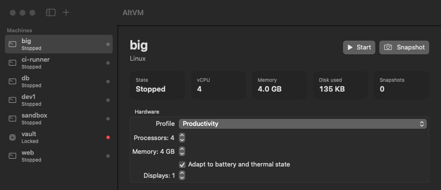

<h1 align="center">AltVM</h1>

<p align="center">
  <b>Free, open-source Parallels Desktop alternative for Apple silicon Macs.</b><br>
  Run Linux and macOS virtual machines on M1, M2, M3, M4 and M5 Macs. Use the native app, a full CLI or a REST API,<br>
  and let AI agents control VMs through a built-in MCP server and computer-use API.
</p>

<p align="center">
  <a href="#quick-start">Quick start</a> ·
  <a href="docs/getting-started.md">Getting started guide</a> ·
  <a href="docs/cli.md">CLI reference</a> ·
  <a href="docs/ai-agents.md">AI agents &amp; MCP</a> ·
  <a href="#faq">FAQ</a>
</p>

<p align="center">
  
  
  
  
  
</p>

<p align="center">
  
</p>

AltVM is a native virtual machine manager for Apple silicon, built directly on Apple's
**Virtualization.framework** (the same hypervisor layer used by macOS itself). It includes everything Parallels Desktop
splits across Standard, Pro, Business and Enterprise editions, all in one free build with no vCPU or RAM caps.
It also adds features no desktop hypervisor ships today:

- **Linux VM in under 10 seconds.** Debian or Ubuntu cloud images are provisioned unattended with your user, SSH keys,
  shared folders and Rosetta for x86-64 binaries.
- **macOS VMs, fully automatic.** It downloads the newest macOS your Mac supports, installs it and creates the user.
- **Built for AI agents.** Screenshots, mouse and keyboard work for any VM, there is an
  **[MCP server](docs/ai-agents.md)** for Claude Code, Claude Desktop and other MCP clients, and a built-in
  computer-use agent that takes a rollback snapshot before it starts.
- **Live snapshots with RAM**, instant copy-on-write clones, disposable VMs and **0.65-second resume**.
- **Enterprise controls:** signed policies, signed golden images, encrypted VMs with IT key escrow, a
  tamper-evident audit log, fleets as code, a REST API, a web console and Prometheus metrics.

## Contents

- [Quick start](#quick-start)
- [Why AltVM](#why-altvm)
- [AltVM vs Parallels Desktop, VMware Fusion, UTM and VirtualBox](#altvm-vs-parallels-desktop-vmware-fusion-utm-and-virtualbox)
- [Features](#features)
- [Benchmarks](#benchmarks)
- [Run AI agents in a VM sandbox (MCP + computer use)](#run-ai-agents-in-a-vm-sandbox-mcp--computer-use)
- [Limitations](#limitations)
- [FAQ](#faq)
- [Architecture](#architecture) · [Contributing](#contributing) · [License](#license)

## Quick start

**Requirements:** a Mac with Apple silicon (M1 or newer) and Xcode with the macOS 27 SDK to build. The app targets macOS 15
and later and has been tested on macOS 27.2.

```bash
git clone https://github.com/GagnDeep/altvm.git
cd altvm
./scripts/build.sh                      # builds and signs dist/AltVM.app and dist/avm
sudo ln -sf "$PWD/dist/avm" /usr/local/bin/avm

# A Debian 13 Linux VM, provisioned and running in about 10 seconds
avm create dev --catalog debian-13 --start
avm exec dev -- uname -a                # runs inside the VM: no SSH or network needed
avm ssh dev                             # or a normal SSH session
```

Prefer a window? Open `dist/AltVM.app`, click **+**, choose an OS and press **Create**.
Continue with the **[getting started guide](docs/getting-started.md)**.

<details>
<summary><b>More one-liners</b></summary>

```bash
avm create ubuntu --catalog ubuntu-24.04 --cpus 4 --memory 8G --start   # Ubuntu Server VM
avm create mac --macos --start                                         # macOS VM (downloads the IPSW from Apple)
avm start dev --gui                                                    # open the VM in a window
avm snapshot create dev before-upgrade                                 # live snapshot including RAM
avm clone dev dev2                                                     # instant copy-on-write clone
avm suspend dev && avm start dev                                       # suspend to disk, resume in about 0.65 s
avm screenshot mac shot.png && avm key mac cmd+space                   # computer use on any VM
avm mcp                                                                # MCP server for AI agents (stdio)
```
</details>

## Why AltVM

| If you want… | AltVM gives you |
|---|---|
| A **free Parallels alternative** for Linux and macOS VMs | Every feature in one MIT-licensed build: no subscription, editions or caps |
| To **run Linux on an M1, M2, M3 or M4 Mac** | Debian 12/13 and Ubuntu 24.04 provisioned unattended in seconds, plus installer ISOs |
| A **macOS virtual machine** for testing, CI or a clean dev box | Fully automatic install of the latest macOS your Mac supports |
| A **safe sandbox for AI agents** | Screenshot, mouse and keyboard APIs, an MCP server, rollback snapshots and isolated network mode |
| **Vagrant- or Terraform-style automation** on Apple silicon | `avm apply fleet.json` (plan and apply, idempotent), a REST API, and golden images |
| **Managed VMs for a team** | Signed policies (fail closed), encrypted VMs with IT escrow, and a hash-chained audit log |

## AltVM vs Parallels Desktop, VMware Fusion, UTM and VirtualBox

| | **AltVM** | Parallels Desktop | VMware Fusion | UTM | VirtualBox |
|---|---|---|---|---|---|
| Price | **Free** | Paid subscription | Free | Free (paid on App Store) | Free |
| Open source | **Yes (MIT)** | No | No | Yes | Yes (GPL) |
| Engine on Apple silicon | Apple Virtualization.framework | Own hypervisor | Own hypervisor | QEMU or Virtualization.framework | Own hypervisor |
| Linux guests | ✅ unattended in about 10 s | ✅ | ✅ | ✅ | ✅ |
| macOS guests | ✅ fully automatic | ✅ | — | ✅ | — |
| Windows 11 on Arm guests | ❌ ([why](#limitations)) | ✅ | ✅ | ✅ (QEMU) | — |
| Built-in MCP server and computer-use API for AI agents | ✅ | — | — | — | — |
| Full CLI + REST API + web console | ✅ | CLI (Pro); REST via separate DevOps service | CLI | CLI | CLI |
| Signed policies, golden images, encrypted VMs with escrow | ✅ | Business/Enterprise | — | — | — |

<sub>Competitor columns summarise publicly documented features at the time of writing and may change; check each vendor's site.
Parallels, VMware Fusion, UTM and VirtualBox are trademarks of their respective owners. AltVM is an independent
project and is not affiliated with or endorsed by any of them.</sub>

**Use Parallels Desktop or VMware Fusion if you need Windows.** Use AltVM for Linux, macOS, automation and AI agents.

## Features

Status key: ✅ built and verified on real VMs · 🧪 built and unit-tested, not yet exercised end to end · ❌ not possible on Virtualization.framework

### Run Linux and macOS on Apple silicon
- ✅ **Linux cloud images, unattended:** Debian 12, Debian 13 and Ubuntu 24.04 come up with your user, SSH keys, guest agent, shared folders and Rosetta. A native qcow2→raw converter means no QEMU is needed.
- ✅ **Installer ISOs:** Ubuntu Desktop and Debian netinst, with filenames resolved and checksums verified automatically, or bring any ARM64 ISO with `--iso`.
- ✅ **macOS guests:** `avm create mac --macos` fetches the latest IPSW your Mac supports, installs it, and creates the user and SSH. Verified end to end with macOS 27.2.1.
- ✅ **Rosetta for Linux:** run x86-64 Linux binaries inside ARM64 Linux VMs.
- ✅ **FastBoot:** after provisioning, the guest's own kernel and initrd are booted directly, giving about 4–5 s cold boots. Kernel upgrades are picked up automatically.

### Mac integration
- ✅ **Shared folders** over virtio-fs (Desktop, Documents, Downloads or any folder), auto-mounted at `/mnt/mac`, with per-folder read-only.
- ✅ **Retina / HiDPI**, live window resize and up to 4 displays.
- ✅ **Mac keyboard and trackpad** devices for macOS guests, with system shortcuts captured.
- ✅ **USB disk and ISO hot-plug** into running VMs (`avm usb attach`).
- 🧪 Clipboard sharing over SPICE (`spice-vdagent` in the guest).

### Performance
- ✅ Native **Apple Hypervisor** through Virtualization.framework, with no emulation.
- ✅ **Workload profiles** (productivity, development, design, gaming, server, travel) sized from your Mac's real cores and RAM, always leaving the host at least 25% of its RAM.
- ✅ **Travel mode:** fewer vCPUs on battery, in Low Power Mode or under thermal pressure.
- ✅ **Dynamic memory:** a virtio balloon follows host memory pressure automatically (`avm memory <vm> <MiB>` sets it by hand).
- ✅ **Sparse disks** with `avm disk compact` (hole punching plus guest `fstrim`).

### Snapshots, safety and reliability
- ✅ **Snapshot tree with live snapshots that include RAM**, and instant APFS copy-on-write snapshots and clones.
- ✅ **Suspend to disk** with guest clock resync on resume.
- ✅ **Isolated mode:** no NAT, shared folders, clipboard, microphone or USB.
- ✅ **Disposable mode:** every boot starts from a clean baseline.
- ✅ **Crash-consistent disks:** full-sync caching, the guest is flushed before suspend, snapshot and force-stop, and `avm repair` forces a fsck.
- ✅ **Run lock:** a kernel `flock` per VM, so two processes can never boot the same disk.
- ✅ **Secure Enclave-sealed saved states:** a restore on a locked Mac is refused with a clear message instead of being discarded.

### Networking
- ✅ NAT by default, plus userspace L2 **virtual switches** with **built-in DHCP** for private VM-to-VM labs.
- ✅ **Bad-network simulation:** live latency, jitter, packet loss, bandwidth and duplication, with presets (`3g`, `edge`, `satellite`, …).

### Automation and DevOps
- ✅ **`avm` CLI** covering every feature ([reference](docs/cli.md)) and a **REST API** (`avm serve`) with a web console and Prometheus `/metrics`.
- ✅ **vsock guest agent:** `avm exec` with exit codes, stdin and file transfer, with no network or SSH. Works in isolated VMs.
- ✅ **Fleets as code:** `avm apply fleet.json` with plan/apply, idempotent ([example](examples/fleet.json)).
- 🧪 **Nested virtualization** for Linux guests on M3 and newer (`label nested=true`).

### AI agents and computer use
- ✅ **Computer-use API for every VM:** `avm screenshot`, `click`, `double-click`, `right-click`, `move`, `drag`, `scroll`, `key`, `type`, also over REST. No guest software needed.
- ✅ **MCP server:** `avm mcp` exposes 21 tools (lifecycle, snapshots, exec, files, screenshots, mouse and keyboard), scoped with `--vms` and `--no-lifecycle`.
- 🧪 **Built-in Claude agent:** `avm agent <vm> "task"` takes a rollback snapshot, then runs a computer-use loop.
- ✅ **Remote display:** `avm vnc <vm>` opens macOS Screen Sharing with a random password, gated by policy.

### Business and enterprise
- ✅ **Ed25519-signed policy:** limits, OS allow-list, folder roots, clipboard, mic, USB, networking, required encryption, isolation or Secure Boot, signed-images-only, VM expiry and snapshot retention. **A tampered policy locks everything down (fail closed).** See the [example policy](examples/policy.json).
- ✅ **Golden images (`.avmimg`):** sparse, LZFSE-compressed, Ed25519-signed and SHA-256 pinned. Each clone gets a fresh identity (MAC address, hostname, host keys).
- ✅ **Encrypted VMs:** AES-256 encrypted containers, with the passphrase **escrowed to IT** (X25519 + ChaChaPoly) and Keychain unlock.
- ✅ **Hash-chained audit log:** editing or deleting any line is detected, and the JSONL is ready for a SIEM.
- ✅ **MDM-friendly:** policy and trusted keys are plain files in `/Library/Application Support/AltVM/`, so Jamf or Intune can deploy them.

## Benchmarks

Measured on an M-series Mac mini (10 cores, 16 GB RAM) running macOS 27.2:

| Task | Result |
|---|---|
| `avm create --catalog debian-13 --start`, from create to provisioned with the agent answering | **9.6 s** (including a SHA-512 check of the 3 GB image) |
| Cold boot to guest agent ready (FastBoot) | **~4–5 s** |
| Resume from suspend-to-disk | **0.65 s**, processes intact |
| Live snapshot (RAM + disk) of a running VM | **0.73 s** |
| Offline snapshot or clone of a 16 GB VM | **0.03 s**, about 0 bytes (APFS copy-on-write) |
| Golden image of a 17 GB VM | **331 MB**, deployed in **1.3 s** |
| Golden image pack (parallel LZFSE) | **4.4 s** (59 s single-threaded) |
| Live memory balloon | guest RAM **1775 → 760 → 1747 MiB**, no reboot |
| Test suites | 23 unit tests (`swift test`) and 23 end-to-end checks on real VMs (`scripts/e2e.sh`) |

## Run AI agents in a VM sandbox (MCP + computer use)

Give Claude, or any MCP-capable agent, a whole computer to work in, isolated from your Mac and reversible with one command:

```bash
avm create sandbox --catalog ubuntu-24.04 --isolated --start
claude mcp add altvm -- avm mcp --vms sandbox --no-lifecycle   # Claude Code
avm snapshot create sandbox clean                                  # roll back any time
```

The full setup for Claude Desktop, scoping and safety notes is in **[docs/ai-agents.md](docs/ai-agents.md)**.

## Limitations

These come from Apple's Virtualization.framework, not from missing work in AltVM:

- **No Windows guests.** Windows 11 on Arm's boot manager stalls before Setup on Virtualization.framework. For Windows,
  use Parallels Desktop, VMware Fusion or UTM's QEMU backend.
- **No 3D acceleration (DirectX or OpenGL) for Linux guests.** macOS guests get Apple's paravirtualized Metal GPU.
- **Firmware-stage graphics are not shown** in the display capture (EFI and GRUB menus appear black). Keyboard input still reaches them.
- **Physical USB passthrough** and **bridged networking** need Apple-granted entitlements
  (`com.apple.developer.accessory-access.usb`, `com.apple.vm.networking`).
- **Suspend for EFI-booted Linux guests can fall back to a cold boot.** Catalog VMs use FastBoot, which avoids this.

## FAQ

<details>
<summary><b>Is AltVM a free alternative to Parallels Desktop?</b></summary>

Yes. AltVM is free and open source under the MIT license, with no subscription, editions or vCPU and RAM limits.
It covers Linux and macOS virtual machines plus the Pro and Enterprise features (CLI, REST API, policies, golden images,
encryption, audit). It does not run Windows; see [Limitations](#limitations).
</details>

<details>
<summary><b>How do I run Linux on an M1, M2, M3 or M4 Mac?</b></summary>

Install AltVM and run `avm create dev --catalog debian-13 --start` (or `--catalog ubuntu-24.04`). The VM is
provisioned with your user and SSH key in about 10 seconds. Open a shell with `avm ssh dev`. See the
[getting started guide](docs/getting-started.md).
</details>

<details>
<summary><b>Can I run a macOS virtual machine on Apple silicon?</b></summary>

Yes. `avm create mac --macos --start` downloads the latest macOS your Mac supports from Apple, installs it and creates
the user automatically. Apple's license allows up to two additional macOS VMs per Mac.
</details>

<details>
<summary><b>Can AltVM run Windows 11?</b></summary>

No. Windows 11 on Arm does not boot on Apple's Virtualization.framework, which AltVM is built on. Use Parallels Desktop,
VMware Fusion or UTM (QEMU backend) for Windows.
</details>

<details>
<summary><b>How is it different from UTM?</b></summary>

Both are free and open source. AltVM uses only Virtualization.framework and focuses on automation: unattended Linux
provisioning, a full CLI and REST API, live RAM snapshots, golden images, policies and fleets, plus an MCP server and
computer-use API for AI agents. UTM also offers QEMU emulation, which is how it runs Windows and other CPU architectures.
</details>

<details>
<summary><b>Is it a VirtualBox or Vagrant replacement on Apple silicon?</b></summary>

For ARM64 Linux and macOS guests, yes: `avm apply fleet.json` declares VMs as code (plan/apply, idempotent), and
golden images play the role of Vagrant boxes. x86 guests are not emulated, but Rosetta runs x86-64 Linux *binaries*
inside ARM64 Linux VMs.
</details>

<details>
<summary><b>Can AI agents like Claude control the VM?</b></summary>

Yes. `avm mcp` is a Model Context Protocol server with 21 tools: screenshots, mouse, keyboard, exec, files,
snapshots and lifecycle. Add it to Claude Code with `claude mcp add altvm -- avm mcp`. See [AI agents & MCP](docs/ai-agents.md).
</details>

<details>
<summary><b>How fast is it compared with Parallels?</b></summary>

Both run guests on Apple's hardware hypervisor, so CPU speed is near native in either. AltVM focuses on lifecycle
speed: about 10-second provisioned Linux VMs, about 4–5 s cold boots, 0.65 s resume and 0.03 s clones. See [Benchmarks](#benchmarks).
</details>

<details>
<summary><b>Does it work on Intel Macs?</b></summary>

No. AltVM targets Apple silicon (arm64) only.
</details>

## Architecture

```
Sources/AltVMCore     engine: spec → VZ configuration, runner (one process per VM), snapshots, disks (sparse/CoW/compact),
                      qcow2, catalog + cloud-init, guest agent, virtual switch + DHCP, golden images, policy, signing,
                      encryption + escrow, audit chain, fleets, REST API + web console, metrics, remote display (RFB),
                      MCP server, computer-use agent
Sources/avm           CLI (every feature) and the per-VM runtime process (`avm run`)
Sources/AltVMApp      SwiftUI app: library, settings, snapshots, create flow, VM windows, menu bar
guest-agent/          Linux vsock agent (installed automatically by cloud-init)
scripts/              build.sh, e2e.sh, embed-agent.sh
examples/             fleet.json, policy.json
docs/                 guides (getting started, CLI, AI agents)
```

Each VM runs in its own `avm run` process, so a crash in one cannot take the others down. The CLI, REST API, web console,
MCP server and app all drive a running VM through its control socket. VMs live in `~/Library/Application Support/AltVM`
(override this with `ALTVM_HOME`).

## Contributing

Issues and pull requests are welcome. See [CONTRIBUTING.md](CONTRIBUTING.md) for building and testing, and
[SECURITY.md](SECURITY.md) for reporting vulnerabilities.

```bash
swift build && codesign -f -s - --entitlements Resources/avm.entitlements .build/debug/avm
swift test                                  # unit tests (isolated temporary homes)
./scripts/build.sh && ./scripts/e2e.sh      # end-to-end on real VMs (throwaway ALTVM_HOME)
```

If AltVM is useful to you, **star the repo**; it helps other Mac users find it.

## License

[MIT](LICENSE). AltVM is not affiliated with Parallels International GmbH, Broadcom/VMware, UTM or Oracle.
macOS and Apple silicon are trademarks of Apple Inc.
