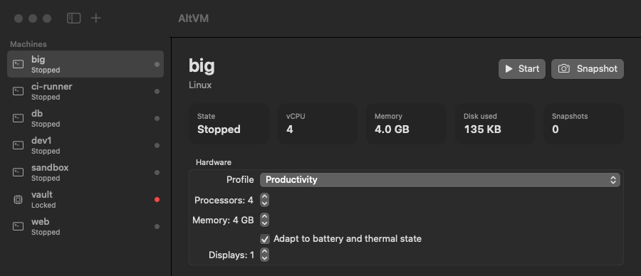

# Free, open-source Parallels Desktop alternative for Apple silicon

**AltVM** runs **Linux and macOS virtual machines** on M1, M2, M3, M4 and M5 Macs. It is built directly on Apple's
Virtualization.framework and is **free and MIT-licensed**: no subscription, no editions, and no vCPU or RAM caps.

<p></p>

```bash
git clone https://github.com/GagnDeep/altvm.git && cd altvm && ./scripts/build.sh
dist/avm create dev --catalog debian-13 --start   # a provisioned Linux VM in about 10 seconds
```

[Get started](getting-started.md){: .btn} [View on GitHub](https://github.com/GagnDeep/altvm){: .btn}

## Highlights

- **Linux VM in about 10 seconds.** Debian and Ubuntu are provisioned unattended with your user, SSH keys, shared folders and Rosetta for x86-64 binaries. → [Run Linux on Apple silicon](run-linux-on-mac.md)
- **macOS virtual machines, fully automatic:** download, install and user setup. → [macOS VM guide](macos-vm.md)
- **Sandbox for AI agents.** Screenshot, mouse and keyboard APIs, a built-in **MCP server** for Claude Code and Claude Desktop, and rollback snapshots. → [AI agents & MCP](ai-agents.md)
- **Live snapshots with RAM**, instant copy-on-write clones, **0.65 s resume**, and disposable and isolated modes.
- **Automation:** a CLI for everything, a REST API, a web console, Prometheus metrics, and fleets as code. → [CLI reference](cli.md)
- **Enterprise:** signed policies (fail closed), signed golden images, encrypted VMs with IT key escrow, and a hash-chained audit log.

## How it compares

AltVM covers what Parallels Desktop splits across its Standard, Pro, Business and Enterprise editions, for Linux and
macOS guests. It does **not** run Windows, because Windows on Arm does not boot on Apple's Virtualization.framework.
→ [AltVM vs Parallels, VMware Fusion, UTM and VirtualBox](parallels-alternative.md)

## Documentation

- [Getting started](getting-started.md): install, first VM, shared folders, snapshots, macOS, troubleshooting
- [Run Linux on an M1/M2/M3/M4 Mac](run-linux-on-mac.md)
- [Create a macOS virtual machine](macos-vm.md)
- [AI agents, MCP and computer use](ai-agents.md)
- [CLI reference](cli.md)
- [Comparison with Parallels, VMware Fusion, UTM and VirtualBox](parallels-alternative.md)

<small>AltVM is an independent open-source project, not affiliated with Parallels, Broadcom/VMware, UTM or Oracle.</small>
